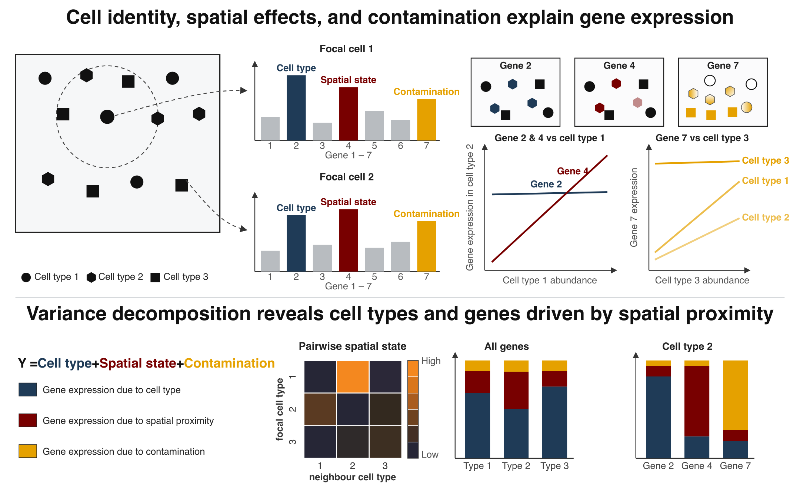

PACE
======================================================
A hierarchical empirical Bayes framework for `proximity-associated changes in expression` — how a cell's gene
expression shifts near specific neighbouring cell types — in `imaging-based spatial transcriptomics` (Xenium, CosMx).



Overview
--------

**PACE** quantifies how proximity to specific neighbouring cell types reshapes a cell's gene expression. It fits
hierarchical `negative binomial mixed models` with partial pooling across cell types, corrects for transcript
`contamination` between adjacent cells with a per-cell ambient term, and decomposes expression variance into
`cell-type identity`, `spatial cell state`, `contamination`, and `residual` components. A per-gene `driver score`
ranks the genes that mediate each focal–neighbour relationship.

Input and output follow [`AnnData`](https://anndata.readthedocs.io) conventions:
a single call to `pace_fit()` returns a `PaceFit` object, read out with `neighbour_slopes()`,
`variance_decomposition()`, and `top_drivers()`. See `examples/demo.py` for a worked breast cancer example and
[`docs/usage.md`](docs/usage.md) for the readouts and options in full.

```python
import pace

fit = pace.pace_fit(adata, cell_type="cell_type")
pace.top_drivers(fit, "Macrophage", "Tumour").to_dataframe().head()
```

This is the Python implementation. PACE is also an
[R/Bioconductor package](https://github.com/ecool50/PACE); both compile the same C++ core, so a fit is the same
fit in either language.

Installation
--------
`PACE` requires a C++ compiler and `Eigen 3.4` for the contamination-correcting solver. Installing a released
wheel avoids both.

```sh
pip install pace-spatial
```

For the development version:
```sh
pip install "git+https://github.com/ecool50/pace-python"
```

Building from source needs Eigen 3.4 specifically — later majors reduce in a different order and move the fitted
effects — and, on macOS, Apple's toolchain rather than a conda or Homebrew `clang`:

```sh
bash tools/fetch_eigen.sh
EIGEN_INCLUDE_DIR=$PWD/eigen-3.4.0 CC=/usr/bin/clang CXX=/usr/bin/clang++ \
  LDSHARED="/usr/bin/clang -bundle -undefined dynamic_lookup" pip install -e ".[all]"
```

### Submitting an issue or feature request

`PACE` is still under active development. We would greatly appreciate any and
all feedback related to the package.

* Python package related issues should be raised [here](https://github.com/ecool50/pace-python/issues).
* For general questions and feedback, please contact us directly via [ewil3501@uni.sydney.edu.au](mailto:ewil3501@uni.sydney.edu.au).


## Author

* **Elijah Willie**
* **Shreya Rajesh Rao**
* **John Ormerod**
* **Ellis Patrick**  - [@TheEllisPatrick](https://twitter.com/TheEllisPatrick)
