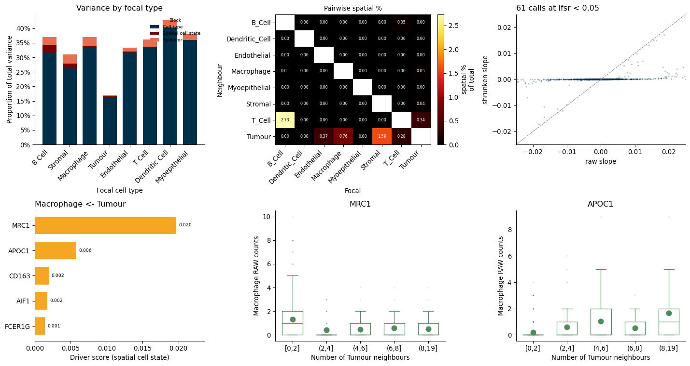

# Using PACE

The [overview](index.md) is the short version. This is the reference: what
each readout gives you, the figures, and the handful of settings worth
knowing about.

## The readouts

**`pace_model` — the model.** One slope per
(focal type, neighbour type, gene), with a per-cell contamination loading and
gene-wise overdispersions. Given an `AnnData` it reads coordinates from
`obsm["spatial"]`, labels and condition from `obs`, gene names from
`var_names` and counts from `X` or a `layer`, and never modifies it.

**`pace_shrink` — which slopes to believe.** Raw slopes are mostly noise.
Multivariate adaptive shrinkage pools them, one mixture per neighbour type
with the focal types as its conditions, and returns every slope with a local
false sign rate. `slopes.calls()` reports how many effects are called and how
many of those are expected to have the wrong sign.

**`pace_decompose` — where a gene's variance comes from.** Per focal type and
gene, split into cell-type identity, the baseline spatial effect, the
condition-by-space interaction, contamination, and dispersion. Useful for the
question "is this gene's variation about *where* the cell is at all?"
**`single_frame_decomposition`** gives the observed version, where the
magnitudes are measured from the data and only the split within a cell type
comes from the model.

**`pace_drivers` — which genes carry a relationship.** Per pair, genes ranked
by `b² · spec² · focal_mean`. Squaring the slope makes the score
direction-blind, so a gene pushed down ranks alongside one pushed up;
specificity and expression level keep a barely-expressed gene off the top on a
noisy slope. Filtered at lfsr < 0.05.

**`pair_variance` — which neighbours matter to which cell types.** Each focal
type's spatial variance split across its neighbours, so a row sums to that
type's spatial share and the own-type pair is excluded.

**`plot_*`** — five figures over the above.

Three more: `build_neighbourhood()` and `ambient_field()` return the kernels
and the contamination field without fitting, for checking what the model is
being given; `anchor_genes()` lists the genes that mark each type and so
anchor its contamination; `stash_pace()` copies the readouts into
`adata.uns`, and `compact_fit()` drops the rebuildable bulk from a fit you
want to keep.

## Figures



```python
pace.plot_decomposition(frame)                 # full bar + the rescaled zoom
pace.plot_pair_heatmap(pairs, fit.cell_types)
pace.plot_drivers(drivers, "Macrophage", "Tumour", single_frame=frame)
pace.plot_proximity(fit, counts, ["MRC1", "APOC1"], "Macrophage", "Tumour")
pace.plot_shrinkage(slopes)
```

Two are worth knowing about. `plot_decomposition` leaves the residual block
out, so its bars stop well short of 100%: the comparison is between the parts
the model attributes, and a residual bar towering over the rest would tell you
nothing. `plot_drivers` takes `single_frame=` to add a companion panel showing
what each top gene's variance is made of, which catches a gene that ranks
highly because the focal type simply expresses a lot of it.

Every panel returns matplotlib axes, so saving is ordinary matplotlib. For
publication, write PDF with Type 42 fonts, which keeps text editable and avoids
the Type 3 fonts journals reject:

```python
import matplotlib
matplotlib.rcParams["pdf.fonttype"] = 42
axis, zoom = pace.plot_decomposition(frame)
axis.figure.savefig("decomposition.pdf", bbox_inches="tight")
```

## Things worth setting

**Give it counts.** `adata.X` holds whatever the last preprocessing step left
there, and a negative binomial fit of log-normalised values will converge and
report slopes that mean nothing. Non-integer values are refused; point `layer`
at the raw counts.

**Name the reference arm** of a condition. Its first level is what every other
arm is contrasted against, so it decides what the baseline slopes mean and
which way the interaction points — this is not a relabelling. Leaving
`condition_levels` unset picks one for you and warns.

```python
fit = pace.fit_anndata(adata, "cell_type", condition_key="Responder",
                       condition_levels=["non-responder", "Responder"])
```

**`kernel_per_image`** is `False`: the neighbour search runs across the whole
object even when it has several images, which is what fields of view from one
section want. Set it `True` when the images are genuinely separate samples.

**`types=`** fixes the cell type order, and so the row order of everything
downstream. The default sorts the observed labels.

**`ambient_mode="stream"`** avoids materialising the cells-by-genes
contamination field, which runs to several GB at a million cells. It is a
memory setting and nothing else — the fit is identical either way.

**On a condition fit, `pace_shrink` returns the responder layer**, the
condition-by-neighbour interaction, not the baseline proximity effect.

## Tests

```sh
pip install -e ".[test]"
python -m pytest tests
```

From a non-editable install, run them from outside the checkout
(`cd /tmp && python -m pytest /path/to/pace-python/tests`): the repository root
holds the source package `pace/`, which shadows the installed one but has no
compiled `_core`, and the resulting ImportError blames a circular import rather
than the real cause.

## Building from source

Two things are not free choices.

**Eigen must be 3.4.** Later majors vectorise and reduce in a different order,
which moves the fitted effects by about 3e-4, so the build refuses them:

```sh
bash tools/fetch_eigen.sh && EIGEN_INCLUDE_DIR=$PWD/eigen-3.4.0 pip install -e .
```

`PACE_ALLOW_ANY_EIGEN=1` builds anyway. Installing a released wheel avoids the
question entirely.

**On macOS, use Apple's toolchain.** A conda or Homebrew `clang` brings an old
`ld64` that links a shared object which loads nowhere — the build succeeds and
it fails at import with `mis-aligned LINKEDIT string pool`:

```sh
CC=/usr/bin/clang CXX=/usr/bin/clang++ \
  LDSHARED="/usr/bin/clang -bundle -undefined dynamic_lookup" pip install -e .
```

`ld -v` should report `PROJECT:ld-27037` or newer.
